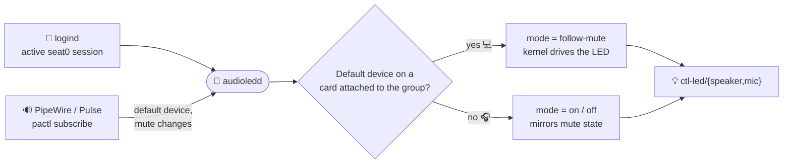

# 🔇💡 audioledd

Makes the laptop's speaker and mic mute LEDs follow the *default* sink and
source, e.g. a Bluetooth headset 🎧, rather than only the built-in sound card.

| You mute… | Without audioledd | With audioledd |
|---|---|---|
| 💻 Built-in speakers | 🟠 LED on | 🟠 LED on |
| 🎧 Bluetooth headset | ⚫ LED stays dark | 🟠 LED on |
| 🎙️ USB mic | ⚫ LED stays dark | 🟠 LED on |

## 🤔 Why

The `audio-mute`/`audio-micmute` LED triggers are fed by the kernel's
`snd-ctl-led`, which only sees ALSA mixer controls. Muting a Bluetooth device
happens entirely in PipeWire, so the LEDs stay dark.

## ⚙️ How

`snd-ctl-led` has a mode per LED group in
`/sys/class/sound/ctl-led/{speaker,mic}/mode`: `follow-mute` (default),
`follow-route`, `on` and `off`. The daemon follows the active session of
`seat0` through logind, listens to `pactl subscribe` as that session's user,
and per group:

* 💻 default device is on a card attached to the group
  (`ctl-led/<group>/cardN`): `follow-mute`, so the kernel drives the LED as
  usual;
* 🎧 otherwise: `on`/`off` mirroring the device's mute state.



🛟 The LED triggers are never touched, so the built-in card keeps working if
the daemon dies. It resets to `follow-mute` when stopped.

🔐 The `mode` files are root-only. logind grants seat access through ACLs
(`uaccess`), but only on `/dev` nodes, and sysfs doesn't support ACLs. So
this is a root system service, which runs `pactl` as the session user and
only writes sysfs as root. 🔀 Switching user or VT switches which sound
server is followed.

## 📦 Install

```sh
dpkg-buildpackage -us -uc -b
sudo apt install ../audioledd_*_all.deb
systemctl status audioledd
```

🧪 `audioledd -n -v` shows what it would do without writing anything. It can
run as your own user, against your own session.

## ⚠️ Caveat

On some ThinkPads (reported on a T14 Gen 2 AMD), forcing the speaker LED
`on` also mutes the built-in speakers, presumably through the EC. Here that
only happens while a non-built-in default sink is muted.
